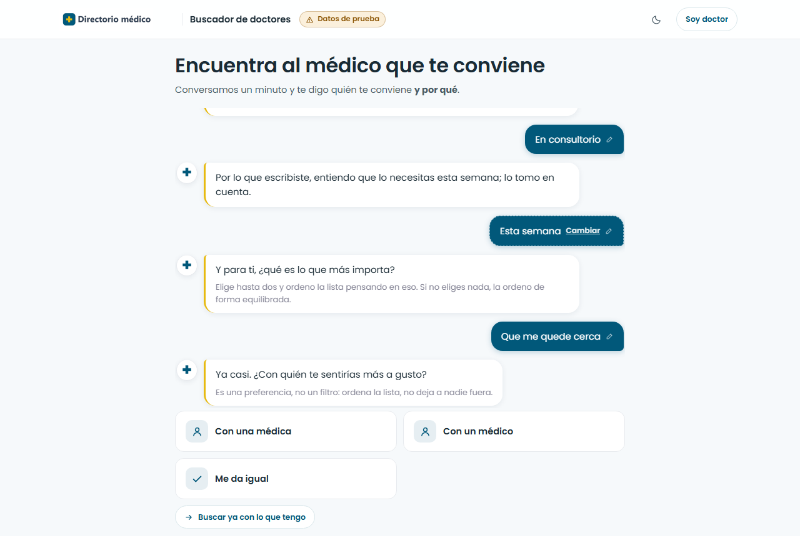
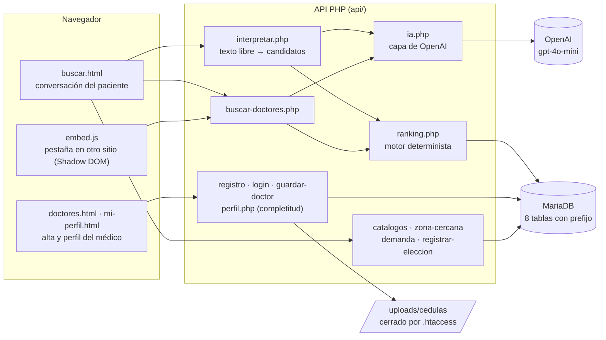
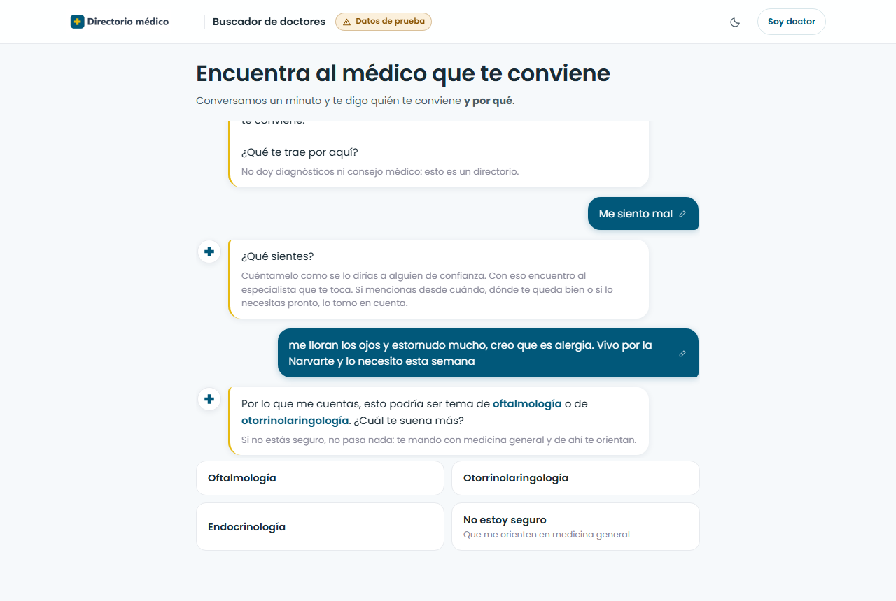
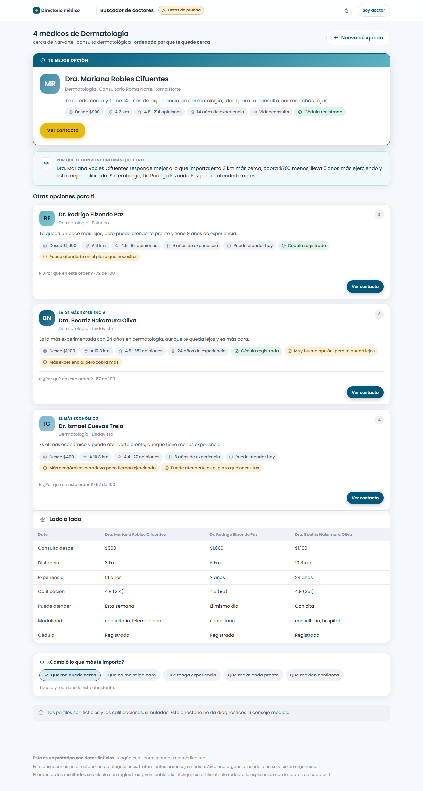
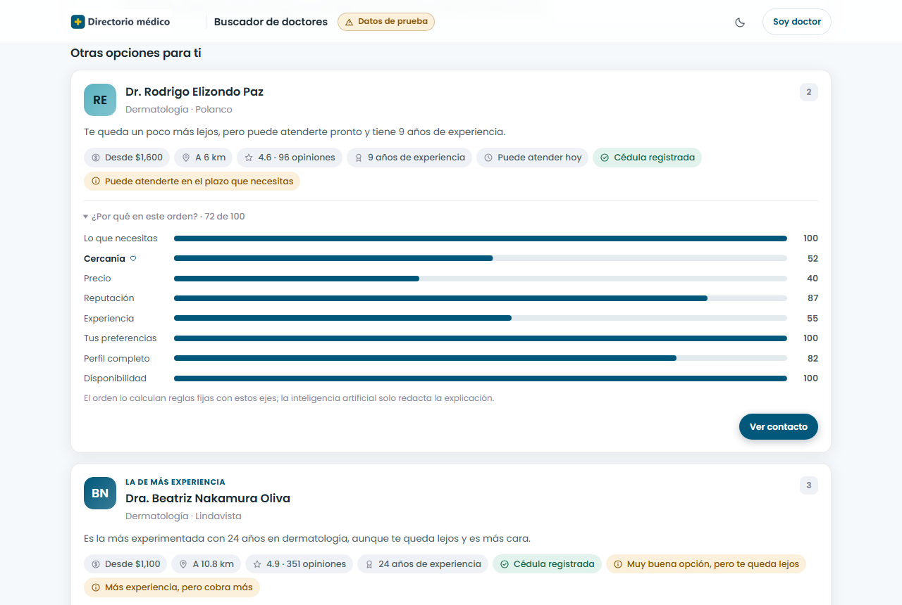
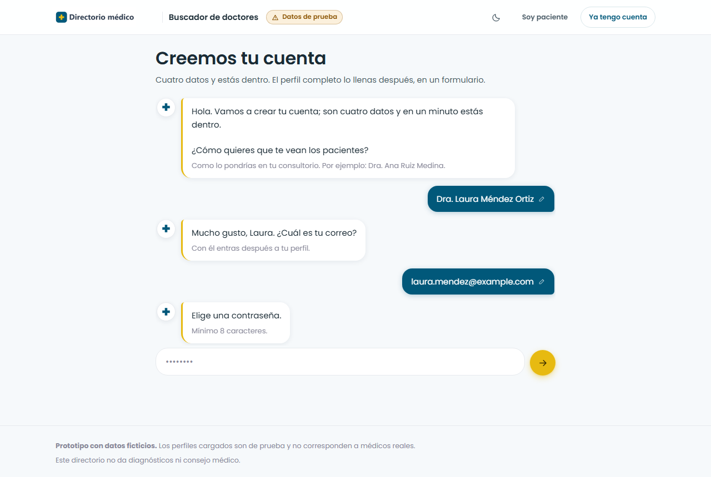
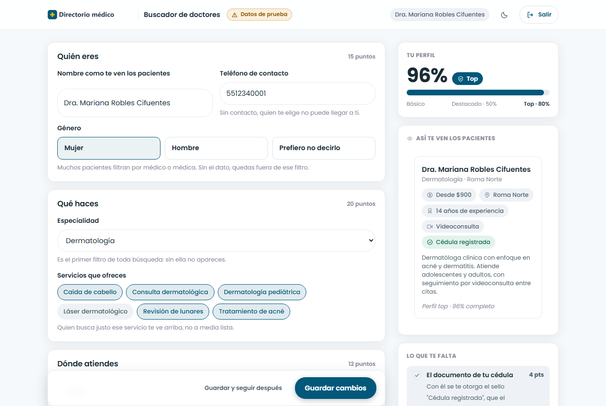
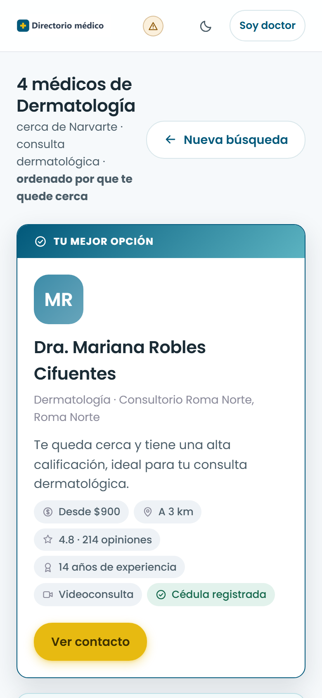

# Buscador de Doctores

Buscador y recomendador de médicos **conversacional**. El paciente cuenta qué le pasa en
una conversación corta y recibe médicos ordenados por varios criterios, con una
explicación de por qué le conviene cada uno y los contrastes honestos ("muy buena, pero
te queda lejos").

> **Prototipo con datos ficticios.** Los 25 perfiles de médicos son inventados. No es
> consejo médico ni diagnóstico: es un directorio. Lo desarrollé para una plataforma de
> salud cliente de TEDE Consultores, y se publicó como prototipo en su sitio.



## Qué problema resuelve

Un directorio médico típico pide elegir la especialidad y luego filtrar. Eso supone que
el paciente sabe qué especialista necesita y cómo comparar entre opciones. Este buscador
pregunta por el **motivo** ("¿qué sientes?"), aclara cuando el texto es ambiguo y ordena
a los médicos con criterios explícitos que el paciente puede revisar.

Del lado del médico, el alta pide cuatro datos y el perfil muestra cuánto falta para
aparecer mejor en las búsquedas, con beneficios reales y no inflados.

## Funcionalidades

**Paciente**

- Conversación guiada: motivo, detalle, para quién, dónde, modalidad, urgencia,
  prioridades y preferencias opcionales, con un resumen final editable.
- Interpretación del texto libre: devuelve **candidatos** de especialidad con su
  confianza y, si hay empate, pregunta en vez de adivinar.
- Ubicación con permiso explícito y cálculo de distancia por Haversine contra un catálogo
  de zonas, sin geocodificador externo.
- **Ranking determinista** con 8 ejes; los pesos se ajustan a lo que el paciente declaró
  y sus prioridades pesan más.
- Resultados como arquetipos ("Mejor en general", "El más cercano", "El más económico"…)
  con el **porqué** redactado por IA a partir de los datos calculados.
- Desglose del puntaje por eje ("¿Por qué en este orden?"), para que el orden sea
  auditable.
- Cualquier respuesta se puede tocar para corregirla; la conversación se rebobina a ese
  punto.
- Embebible en otra página con una sola etiqueta `<script>`, aislado en Shadow DOM.

**Médico**

- Alta conversacional: nombre, correo, contraseña y cédula.
- Perfil en formulario con medidor de completitud y vista previa en vivo. La completitud
  y el nivel los calcula solo el servidor.
- Métricas: cuántas veces apareció en resultados y cuántas lo eligieron, más la demanda
  agregada de la semana por especialidad y zona.

## Stack

| Capa | Tecnología |
|---|---|
| Backend | PHP 8 sin framework ni Composer |
| Base de datos | MariaDB / MySQL por PDO, solo sentencias preparadas |
| Frontend | HTML, CSS y JavaScript vanilla, sin paso de build ni CDNs |
| IA | OpenAI `gpt-4o-mini` con salida JSON, llamado por cURL |
| Servidor | Apache / LiteSpeed (reglas en `.htaccess`), pensado para hosting compartido |

## Arquitectura



Flujo de una búsqueda:

```
respuestas del paciente → [IA: interpretar] → filtros duros → ranking determinista
                        → arquetipos → [IA: redactar el porqué] → resultados
```

**Regla de diseño:** la IA nunca ordena ni puntúa. Solo traduce el texto libre a los
catálogos que ya existen (y lo que no encaja se descarta) y redacta explicaciones con
datos que el motor ya calculó. Con `BD_IA_ACTIVA=0` el buscador funciona completo, con
explicaciones de plantilla.

El detalle de la conversación, los pesos del ranking y las decisiones de privacidad está
en [`docs/DISENO.md`](docs/DISENO.md).

## Cómo correr en local

**Requisitos:** PHP 8 con las extensiones `pdo_mysql`, `curl`, `mbstring` y `fileinfo`,
y un servidor MariaDB o MySQL. La clave de OpenAI es opcional.

1. **Variables de entorno**

   ```bash
   cp .env.example .env
   ```

   Rellena en `.env` los datos de tu base de datos. Para probar sin IA deja
   `BD_IA_ACTIVA=0`; para usarla, pon tu `OPENAI_API_KEY`.

2. **Base de datos**

   ```sql
   CREATE DATABASE buscador_doctores CHARACTER SET utf8mb4 COLLATE utf8mb4_unicode_ci;
   ```

   ```bash
   php db/cargar.php           # crea las tablas del prefijo y carga los datos ficticios
   php db/cargar.php --reset   # las vacía y las vuelve a cargar
   ```

   El cargador imprime el prefijo (`BD_PREFIJO`) antes de tocar nada.

3. **Servidor**

   ```bash
   php -S 127.0.0.1:8085 -t .
   ```

   - Paciente: <http://127.0.0.1:8085/buscar.html>
   - Alta de médicos: <http://127.0.0.1:8085/doctores.html>
   - Perfil del médico (requiere sesión): <http://127.0.0.1:8085/mi-perfil.html>

   Cuentas de prueba: cualquier correo del seed (por ejemplo
   `mariana.robles@example.com`) con la contraseña `demo1234`.

**En hosting compartido sin SSH:** sube los archivos por FTP, crea la base en el panel e
importa `db/schema.sql` y `db/seed.sql` por phpMyAdmin. Si el prefijo no es `bd_`, hay
que sustituirlo también en los nombres `fk_bd_*` de las claves foráneas. Las variables
van en un `.env` (bloqueado por `.htaccess`) o, si el hosting no lo permite, en
`config.local.php` (ver `config.local.php.example`).

## Capturas

| | |
|---|---|
|  |  |
|  |  |
|  |  |
|  | |

## Mi rol

Proyecto que hice en **TEDE Consultores** para una plataforma de salud: un prototipo
independiente, empezado el 25 de agosto de 2026 y publicado en el sitio del cliente el
11 de septiembre de 2026.

- Diseñé la conversación del paciente y del médico, y el modelo de ranking por ejes con
  sus pesos, filtros y arquetipos.
- Programé el backend en PHP: endpoints, motor de ranking, capa de IA con validación
  contra catálogos y reglas de completitud.
- Programé el frontend sin frameworks: motor de conversación con guiones como datos,
  resultados, perfil del médico y el montaje embebido en Shadow DOM.
- Modelé la base de datos (8 tablas con prefijo configurable) y su cargador.
- Implementé las medidas de seguridad y privacidad: rate limit, CORS con origen
  explícito, subida de cédula validada por tipo MIME real e IP hasheada.
- Lo desplegué en hosting compartido y lo integré como pestaña del panel de pacientes del
  cliente.

## Estado

Prototipo funcional con datos ficticios. El sello del perfil dice "Cédula registrada" y
no "verificada": todavía no se coteja con el registro público de profesiones. Los
pendientes están en [`docs/DISENO.md`](docs/DISENO.md#pendiente).

---

## English summary

**Doctor Finder** is a conversational doctor search and recommendation prototype built
for a Mexican health platform (client of TEDE Consultores). Patients describe
their need in a short guided chat and get doctors ranked across eight criteria, with a
plain-language explanation of each recommendation.

- **Key design rule:** ranking is deterministic PHP code. The LLM (OpenAI `gpt-4o-mini`)
  only maps free text to the existing catalog, validated against it, and writes
  explanations from scores the engine already computed. It works fully with AI disabled.
- **Stack:** PHP 8 (no framework, no Composer), MariaDB via PDO, vanilla HTML/CSS/JS,
  Apache/LiteSpeed shared hosting.
- **Run locally:** copy `.env.example` to `.env`, create the database, run
  `php db/cargar.php`, then `php -S 127.0.0.1:8085 -t .`.
- **My role:** product and ranking design, full backend and frontend, data model,
  security measures and deployment.

All 25 doctor profiles are fictional.
